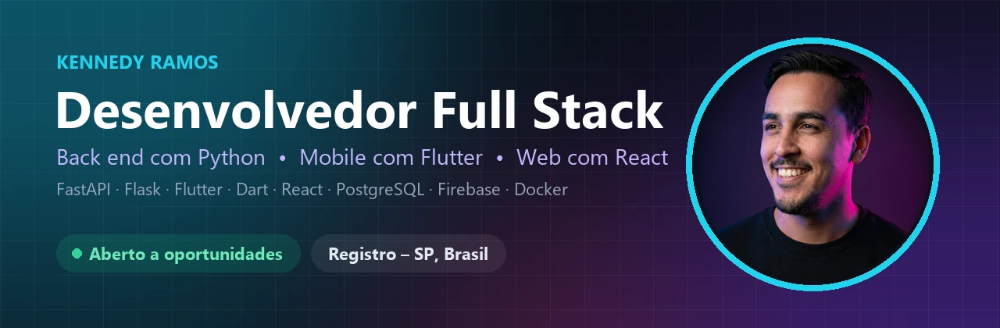
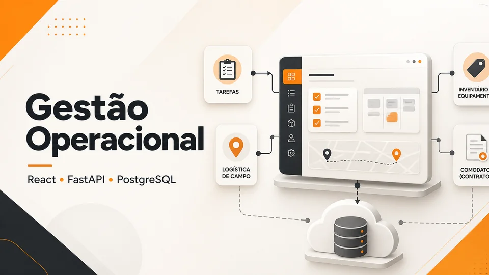
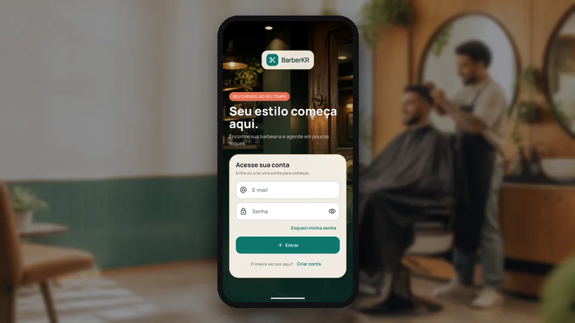
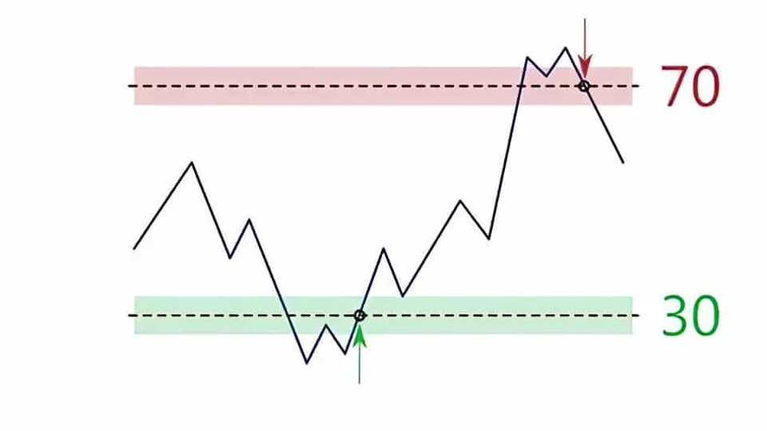
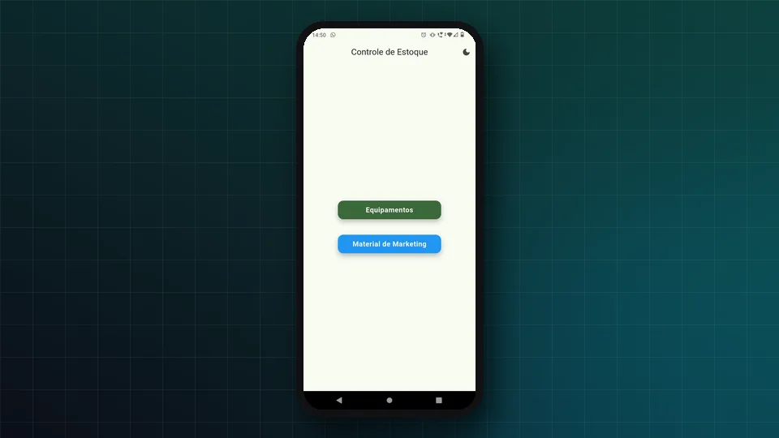

 

## 👋 Sobre mim

Sou **desenvolvedor Full Stack com foco em Python e Flutter**, formado em Análise e Desenvolvimento de Sistemas e cursando **pós-graduação em Análise de Dados e Inteligência Artificial**. Construo **APIs REST, aplicações web e apps mobile de ponta a ponta** — modelagem do banco, regras de negócio, autenticação, interface, testes, CI e deploy em produção.

Venho da **área de TI (suporte e sistemas)** e hoje trabalho com **indicadores, análise de dados (Power BI) e melhoria de processos** na operação comercial da **Ribeira Beer (distribuidora Ambev)** — onde uso no dia a dia o **Gestão Operacional**, plataforma full stack que eu mesmo desenvolvi para resolver problemas reais dessa operação.

## 📌 Em resumo

<table>
  <tr><td>🎯&nbsp;<b>Busco</b></td><td>Desenvolvedor Full Stack • Back End Python • Mobile Flutter</td></tr>
  <tr><td>🧰&nbsp;<b>Stack&nbsp;principal</b></td><td>Python (FastAPI, Flask) • Flutter/Dart • React • PostgreSQL • Firebase</td></tr>
  <tr><td>🎓&nbsp;<b>Formação</b></td><td>Tecnologia em Análise e Desenvolvimento de Sistemas — FACENS (concluído em dez/2025)</td></tr>
  <tr><td>📚&nbsp;<b>Pós&#8209;graduação</b></td><td>Análise de Dados e Inteligência Artificial — em andamento</td></tr>
  <tr><td>📜&nbsp;<b>Certificações</b></td><td>Flutter Development (Google Skills Boost) • Python (SENAI) • Cybersecurity (Santander Open Academy) • Front End React e Back End Java (Adah Tech)</td></tr>
  <tr><td>📍&nbsp;<b>Localização</b></td><td>Registro – SP, Brasil</td></tr>
  <tr><td>💼&nbsp;<b>Freelance</b></td><td>Também desenvolvo projetos sob demanda — <a href="https://kennedyramos-dev.vercel.app">kennedyramos-dev.vercel.app</a></td></tr>
</table>

## 🏆 Destaques técnicos

- 🏭 **Software em uso real** — o Gestão Operacional é usado no dia a dia da operação na **Ribeira Beer (distribuidora Ambev)**, centralizando tarefas, entregas, comodatos e inventário de equipamentos.
- 🔒 **Concorrência resolvida no banco** — reserva de horário com transação atômica: dois clientes nunca ocupam o mesmo horário *(BarberKR)*.
- 💳 **Pagamentos com segurança** — Pix/Mercado Pago em modelo marketplace, preço validado no servidor, webhook assinado e tokens OAuth criptografados com AES-256-GCM *(BarberKR)*.
- 📦 **Dados em volume** — importação em fluxo de arquivos de até **1 GB / 3 milhões de linhas**, com relatórios exportados em Excel *(Gestão Operacional)*.
- 🛡️ **API segura** — JWT com permissões por funcionalidade, limite de tentativas de login compartilhado no PostgreSQL e invalidação de tokens após troca de senha *(Gestão Operacional)*.
- 🔁 **Integrações confiáveis** — fila de envio (outbox) persistente e idempotente, com novas tentativas e expiração de alertas antigos *(RSI Radar)*.
- 🧪 **Qualidade e entrega** — testes com Pytest, Vitest e flutter test, CI no GitHub Actions e deploy em Vercel, Render, Supabase, Firebase e Docker.

## 🚀 Projetos em destaque

<table>
  <tr>
    <td width="50%" valign="top">
      
      <h3>📊 Gestão Operacional</h3>
      
<b>Problema:</b> na operação da Ribeira Beer (distribuidora Ambev), informações espalhadas, consultas lentas e pouca rastreabilidade entre cliente, equipamento e movimentação.

      
<b>Solução:</b> plataforma full stack com tarefas, rotinas, entregas, retiradas, comodatos e inventário — busca global no banco, permissões por perfil, importação de bases e leitura com OCR.

      
<code>React</code> <code>FastAPI</code> <code>Python</code> <code>PostgreSQL</code> <code>Supabase</code> <code>Pytest</code>

      
<a href="https://gestao-de-tarefas-nine.vercel.app"><b>🟢 Em uso na Ribeira Beer</b></a> &nbsp;•&nbsp; <a href="https://github.com/KennnedyRamos/gestao_de_tarefas"><b>📂 Código</b></a>

    </td>
    <td width="50%" valign="top">
      
      <h3>✂️ BarberKR</h3>
      
<b>Problema:</b> barbearias e clientes precisam de agenda confiável, comunicação e pagamento no mesmo lugar.

      
<b>Solução:</b> app com perfis de cliente e barbeiro — descoberta por proximidade, agenda em tempo real, chat, notificações push, painel financeiro e Pix/Mercado Pago.

      
<code>Flutter</code> <code>Dart</code> <code>Firebase</code> <code>Cloud Functions</code> <code>Mercado Pago</code>

      
<a href="https://github.com/KennnedyRamos/barberkr-app"><b>📂 Código</b></a>

    </td>
  </tr>
  <tr>
    <td width="50%" valign="top">
      
      <h3>📈 RSI Radar</h3>
      
<b>Problema:</b> acompanhar o RSI de muitos pares e períodos manualmente é lento e gera alertas repetidos ou atrasados.

      
<b>Solução:</b> worker que calcula o RSI(14) com candles fechados da Binance, guarda o histórico em PostgreSQL e envia só os alertas relevantes no Telegram, com API REST e dashboard.

      
<code>Python</code> <code>Flask</code> <code>PostgreSQL</code> <code>Alembic</code> <code>Docker</code>

      
<a href="https://github.com/KennnedyRamos/API_RSI"><b>📂 Código</b></a>

    </td>
    <td width="50%" valign="top">
      
      <h3>📦 Controle de Equipamentos</h3>
      
<b>Problema:</b> controle interno de equipamentos e materiais de marketing feito de forma manual.

      
<b>Solução:</b> app Android com login, cadastro em tempo real no Firestore, fotos pela câmera e exportação para Excel funcionando offline.

      
<code>Flutter</code> <code>Dart</code> <code>Firebase</code> <code>Android</code>

      
<a href="https://github.com/KennnedyRamos/controle-equipamentos-marketing-flutter"><b>📂 Código</b></a>

    </td>
  </tr>
</table>

## 🧰 Tecnologias

  

| Área | Tecnologias |
|---|---|
| **Back end** | Python, FastAPI, Flask, APIs REST, autenticação JWT, SQLAlchemy, Alembic |
| **Mobile** | Flutter, Dart, Firebase (Authentication, Firestore, Cloud Messaging, Cloud Functions) |
| **Front end** | React, JavaScript, HTML5, CSS3, Material UI |
| **Dados** | PostgreSQL, MySQL, Firestore, Power BI |
| **Entrega** | Git, GitHub Actions, Docker, Linux, Vercel, Render, Supabase |

## 🧭 Trajetória

- 📚 **Pós-graduação em Análise de Dados e Inteligência Artificial** — em andamento
- 🎓 **Tecnologia em Análise e Desenvolvimento de Sistemas** — FACENS, concluído em dez/2025
- 🛠️ **Estágio em TI / Suporte** — suporte a usuários e sistemas, investigação de problemas e melhoria de processos
- 📊 **Ribeira Beer (distribuidora Ambev)** — desde mar/2025: indicadores e análise de dados com Power BI, rotinas no sistema Promax e melhoria de processos — e o Gestão Operacional, sistema que desenvolvi e uso no dia a dia
- 💻 **Desenvolvimento** — APIs, sistemas web e apps mobile com Python, Flutter e React, com testes, CI e deploy (o Gestão Operacional está em uso na Ribeira Beer)

## 📫 Vamos conversar?

Estou **aberto a oportunidades** como Desenvolvedor Full Stack, Back End Python ou Mobile Flutter — e também atendo **projetos freelance**.

<b>🌎 English summary</b>

 

**Full Stack Developer** focused on **Python (FastAPI, Flask)** and **Flutter**, building REST APIs, web apps and mobile apps end to end — data modeling, business rules, authentication, UI, automated tests, CI and production deploys.

- **Operations platform** (React + FastAPI + PostgreSQL), in daily use at Ribeira Beer (an Ambev distributor): global database search, role-based permissions, streaming import of files up to 1 GB.
- **BarberKR** (Flutter + Firebase): transactional booking, chat, push notifications and marketplace payments with server-side validation.
- **RSI Radar** (Python + PostgreSQL): crypto RSI monitoring with an idempotent outbox for Telegram alerts.

Background in IT support and data/process improvement. Graduated in Systems Analysis and Development (FACENS, Dec 2025) and currently pursuing a postgraduate degree in Data Analytics and Artificial Intelligence. Based in Registro – SP, Brazil.
Open to **Full Stack, Python Back End and Flutter** roles — [LinkedIn](https://www.linkedin.com/in/kennedy-silva-ramos-566b00150/) • [Resume (EN)](https://kennnedyramos.github.io/assets/curriculo-kennedy-ramos-en.pdf) • [E-mail](mailto:kennedyrafaelsilvaramos@gmail.com)

<i>💡 Transformando problemas reais em soluções digitais.</i>

